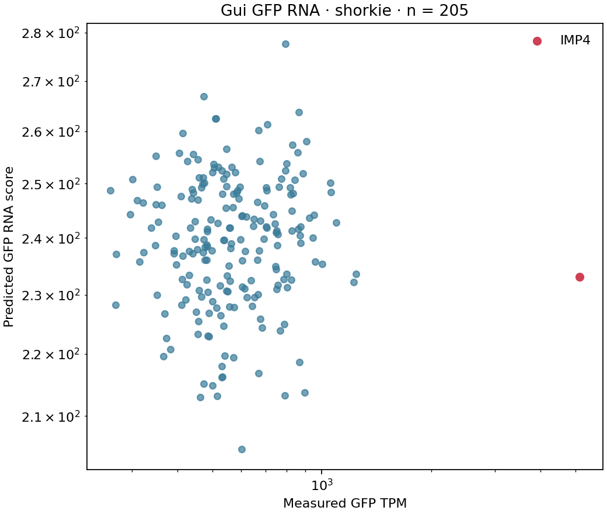
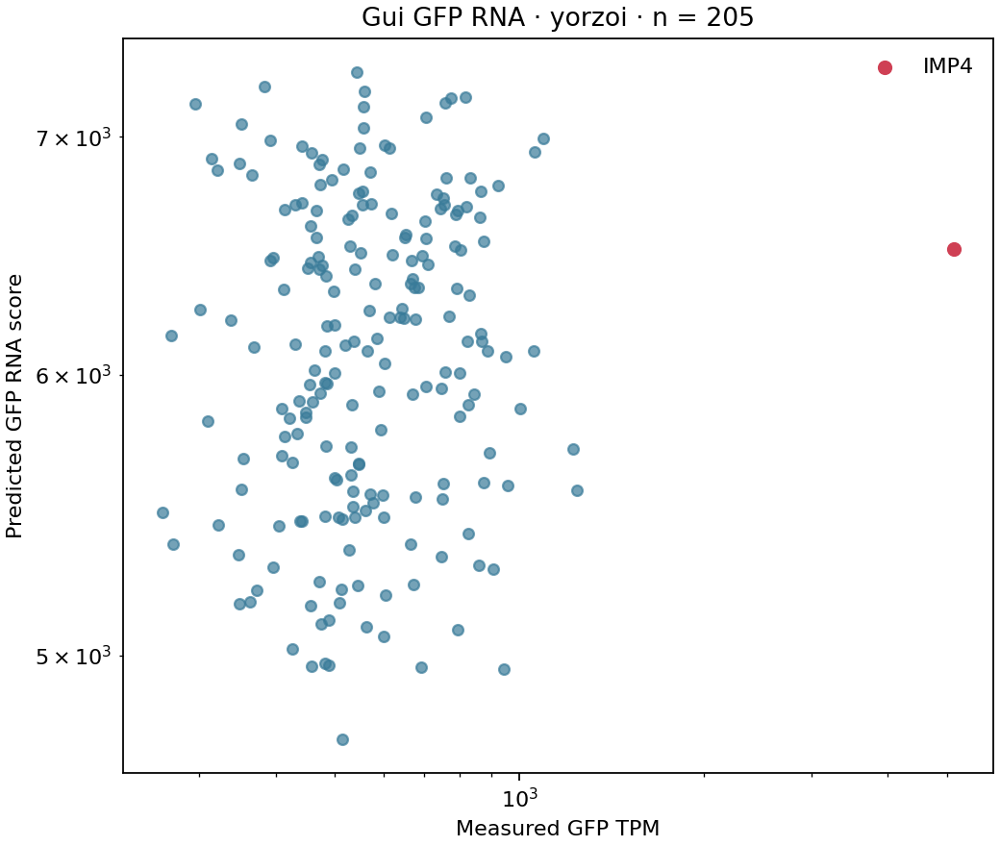

# Gui et al. — GFP RNA abundance across integration sites

`gui_gfp_rna` evaluates zero-shot scalar GFP RNA prediction after heterozygous
gene replacement in diploid yeast. The label is the arithmetic mean deposited
GFP TPM for each engineered genotype. GFP is present only on the edited
homolog, so this task needs neither WT subtraction nor diploid allele mixing.

Source: [Gui et al. 2021](https://doi.org/10.1093/molbev/msab104), using strains
constructed by [Chen and Zhang 2016](https://doi.org/10.1016/j.cels.2016.03.009).
Source URLs and checksums are recorded in
[`scripts/gui/sources.json`](../../scripts/gui/sources.json).

## Dataset and sequence eligibility

There are 240 engineered genotypes and 268 engineered RNA libraries; WT has one
additional library. Of the engineered genotypes, 222 have one library, 13 have
two, two have three, two have four, and one has six. Libraries are averaged
within genotype, and each genotype receives equal weight in evaluation.

The first benchmark cohort contains **205 source-resolved genotypes**. The
other 35 remain in the exported table with explicit exclusions: 22 have
inconsistent older outer-primer records, ten have multiple possible deletion
designs, and three have unresolved genomic homology arms. This selection uses
sequence evidence, without looking at model scores or excluding RNA outliers.

All GFP labels reproduce Table S2 to an absolute tolerance of 1e-6 TPM. The
builder reads the original archived spreadsheet and the GEO abundance tables;
the runtime benchmark reads only these processed files:

```text
data/tasks/gui/
    gui_gfp_rna_v1.tsv
    constructs.fasta
```

The TSV includes `locus_id`, `gfp_tpm`, `n_libraries`, `library_accessions`,
`chrom`, `deletion_start`, `deletion_end`, `cassette_strand`, `construct_id`,
`gfp_cds_start`, `gfp_cds_end`, `sequence_status`, `exclusion_reason` and
`sequence_evidence`. Replacement bounds are 1-based inclusive reference
coordinates. GFP offsets are 0-based half-open offsets inside the payload,
including the stop codon. FASTA payloads are written in GFP transcriptional
orientation and contain the complete DNA between the native genomic junctions.
The reconstructed payload is 3,219 bp, with GFP CDS offsets `[704, 1421)`.
It includes the 3,144 bp PCR cassette and the retained deletion-library tags:
`U1–UPTAG–core–RC(DNTAG)–RC(D1)`. The core already contains U2 and RC(D2).

The core is reconstructed from the published Chen construction primers,
[pFA6a-GFPS65T-kanMX6, AJ002682.1](https://www.ebi.ac.uk/ena/browser/view/AJ002682.1),
[pGSKU, Addgene #72243](https://www.addgene.org/72243/) and the reference RPL5
promoter. Public RNA reads from three strains support the complete 717 bp GFP
CDS. These are source-reconstructed designs, not DNA sequencing of every clone.

The shared R64-5-1 FASTA contains the same chromosome sequences as the original
R64-2-1 release. Replacement intervals are explicitly recorded, rather than
inferred from the newer GTF's native-gene boundaries.

Only `sequence_status=verified` rows enter the adapters. This status means the
source reconstruction has been resolved and its sequence/geometry validated;
it does not imply whole-genome sequencing of each physical strain. Ambiguous
or unresolved records remain in the table with an exclusion reason. An entirely
unresolved dataset fails before model loading. A malformed payload, duplicate
identifier or invalid coding sequence raises an error rather than being silently
repaired. Source evidence remains necessary: an ATG and stop codon alone do not
establish that a payload is the experimentally used construct.

## Model readout

The scaffold replaces the exact native interval with the oriented payload and
centers the input window on the GFP CDS. It requires every CDS base to lie in
the model's readable output crop. The shared cassette helper's older anchor
strategies and the existing Hong/Wu tasks are unchanged.

Shorkie uses all **1,014 tracks from the 1000-RNA-Seq group** (zero-based track
IDs 4201–5214), with the configured eight-fold ensemble and reverse-complement
averaging. Yorzoi uses all **11 Illumina samples**, selecting the matching
reporter strand: plus-strand track IDs 0–10 or minus-strand IDs 81–91. This
includes the ten human-construct samples and SRR21628668; Nanopore tracks are
excluded. Yorzoi retains its existing inverse transformation and
reverse-complement handling. Both sum linear per-base RNA predictions over the
complete GFP CDS and take the arithmetic mean across the selected tracks.
Scores are not calibrated TPM.

These groups replace the initial Shorkie T0 and Yorzoi all-RNA readouts. The
choice was revised after examining per-track and group performance on Gui, so
it was informed by this dataset rather than specified before evaluation.
The sequence cohort, CDS readout and evaluation metrics are unchanged.

Each prediction records the model input's sequence hash, window length, GFP
position, number of readout bases, and amount of native upstream/downstream
context. The different model receptive fields remain visible in these records.

## Evaluation

- Primary: Spearman correlation across integration genotypes.
- Secondary: raw-scale Pearson and log2-scale Pearson. Log Pearson uses only
  positive predictions and reports its own sample count, without a pseudocount.
- Uncertainty: 2,000 paired locus-bootstrap draws, seed 57, percentile 95%
  intervals. These intervals condition on the measured labels and do not
  estimate biological measurement error.
- Outlier sensitivity: repeat metrics without IMP4/YNL075W, while retaining it
  in the primary evaluation. Its unusually high GFP TPM is present in both
  GEO and Table S2.

Constant predictions have undefined correlations, serialized as JSON `null`.
Missing predictions retain explicit reasons. Cross-model comparison uses the
intersection of scored locus IDs and requires identical input-file hashes and
matching labels, so stale results from different sequence reconstructions cannot
be compared silently.

Outputs include `predictions.tsv`, `summary.json`, separate linear/log scatter
PNGs and SVGs, and a common-cohort model comparison. Each new benchmark figure
has one panel; no PDF is written. The summary records input file hashes and
the selected track IDs and aggregation; the CLI also records the run
configuration and code commit.

## Reproduction

Run from the repository root in the installed project environment, with
`pdftotext` available. Source URLs and checksums are in
[`scripts/gui/sources.json`](../../scripts/gui/sources.json). Place the Gui
supplementary ZIP at `archive/msab104_supplementary_data.zip` and the source
downloads under `data/tasks/gui_audit/source/`:

```text
GSE142839_family.soft.gz       GSE142839_RAW.tar
R64-2-1.tgz                   chen2016_mmc1.pdf
chen2016_mmc2.xlsx            Deletion_primers_PCR_sizes.txt
AJ002682.1.embl               pgsku_adelaide_thesis.pdf
Y00454.embl
```

Download the three Addgene #72243 GenBank records into `archive/`, named
`addgene-plasmid-72243-sequence-136113.gbk`,
`addgene-plasmid-72243-sequence-136112.gbk`, and
`addgene-plasmid-72243-sequence-136111.gbk`.

```bash
python scripts/gui/audit_data.py --reference data/tasks/R64-5-1.fa
python scripts/gui/reconstruct_cassette.py
python scripts/gui/build_sequence_map.py
python scripts/gui/build_gui_distribution.py \
  --sequence-map data/tasks/gui_audit/resolved_loci.tsv \
  --constructs data/tasks/gui_audit/resolved_constructs.fasta
ybench data lock --artifacts gui
ybench data verify --tasks gui_gfp_rna
ybench run --config configs/default.yaml --task gui_gfp_rna
```

The sequence map requires
`locus_id`, every geometry column listed above, and `sequence_evidence`.
The builder validates the payload, complete CDS, reference bounds and source
label reconciliation before exporting the runtime distribution. Running the
distribution builder without a sequence map deliberately leaves every sequence
unresolved and cannot produce a scored benchmark.

Use `--device cpu` when no GPU is available. The task currently has no published
data mirror; preparing and locking local files is separate from publishing them.
Alongside the shared reference genome, only the TSV and construct FASTA are
task-specific runtime dependencies. Download caches,
library-level audit tables and build provenance are outside the runtime
distribution allowlist. Runtime code does not import `scripts/`.

## Interpretation

This measures reporter RNA differences across replacement genotypes, not pure
cis effects. Endogenous allele loss can change the trans environment, and TPM
composition can change between strains. Most genotypes lack repeated RNA
measurements. The single WT library is not used as a denominator for this task.
No fluorescence, neighboring-gene or fitness endpoint is evaluated here.

## Results

Both models were rerun on 2026-11-11, sequentially on NVIDIA RTX A6000 GPU 1,
using code commit `b356a5f`. The model settings are now included in
`configs/default.yaml`.
All 205 eligible genotypes produced finite positive predictions; all 717 GFP
CDS bases contributed to every score. The 35 source exclusions are identical
between models.

| Model | n | Spearman ρ (95% CI) | Pearson r | log2 Pearson r |
| --- | ---: | ---: | ---: | ---: |
| Shorkie, 1000-RNA-Seq, eight folds + RC | 205 | 0.060 (−0.077, 0.182) | 0.002 | 0.034 |
| Yorzoi, all Illumina + RC | 205 | 0.096 (−0.045, 0.233) | 0.076 | 0.094 |

Removing IMP4 leaves Spearman ρ = 0.066 for Shorkie and 0.091 for Yorzoi
(n = 204). Neither model shows a clear rank association under this protocol;
the confidence intervals for all three correlations include zero. This does
not identify whether the limitation comes from the models, unobserved strain
variation, trans effects, or measurement variability.

The centered inputs expose about 7.13 kb upstream and 6.04 kb downstream of
native sequence to Shorkie, versus 1.43 kb and 0.34 kb to Yorzoi. These distances
are relative to GFP transcription and exclude the synthetic payload. The models
therefore have different amounts of native genomic context.

Runtime outputs follow the standard layout:
`results/default/{shorkie,yorzoi}__gui_gfp_rna/`. Each contains
`predictions.tsv`, `metrics.json`, the CLI's `summary.json`, and scatter plots.
Predictions retain all exclusions and model-window hashes; metrics retain the
confidence intervals, input hashes, selected tracks, and IMP4 sensitivity.
Cross-model comparison writes `plot.svg` and `common_cohort_metrics.json` under
`results/default/compare/per_task/gui_gfp_rna/`.

The reported runs remain locally under `results/gui_gfp_rna/`. Historical
T0/all-RNA outputs are in `results/gui_gfp_rna_t0_all_rna_v1/`; earlier track
diagnostics refer to those historical readouts.





Linear-scale versions and the shared-cohort comparison are in
[`img/results/gui_gfp_rna/`](../../img/results/gui_gfp_rna/).
